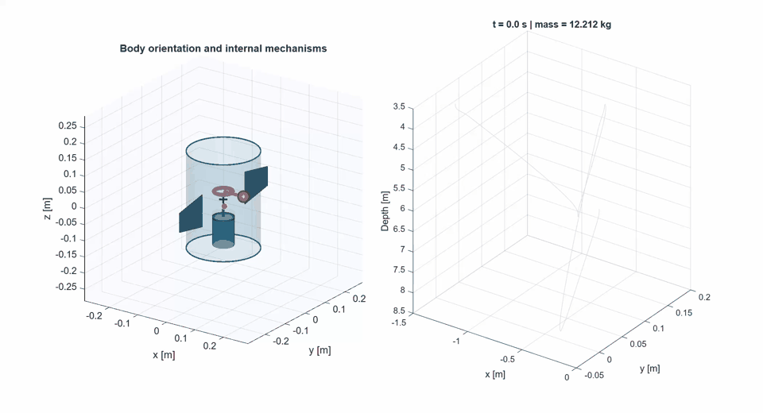
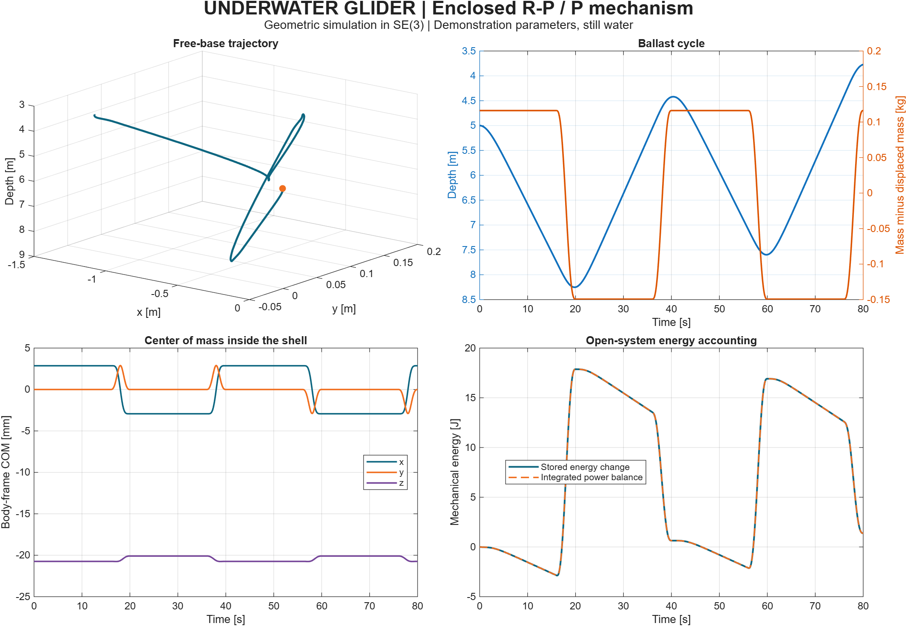
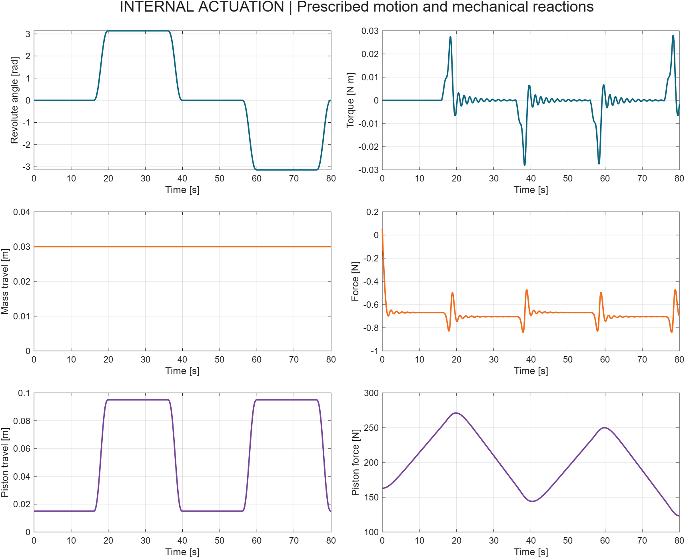

# Underwater Glider Geometric Simulator

**Geometric modeling and MATLAB simulation of an underwater glider with floating-base dynamics, internal moving masses, and variable ballast.**

[](LICENSE)
[](docs/VALIDATION.md)
[](docs/equations/)

The hull encloses a **revolute-prismatic moving-mass mechanism** and a separate **prismatic syringe piston**. The free base evolves on **SE(3)**. Water intake changes the onboard mass while the exterior displaced volume stays fixed.



**[Simulation video (MP4)](results/glider_demo.mp4)** · **[Equations (PDF)](docs/equations/glider_equations.pdf)** · **[Editable LaTeX](docs/equations/main.tex)**

## Quick start

Clone the repository and open its root in MATLAB:

```matlab
setup_glider;
summary = run_glider_demo();
```

The demo simulates 80 seconds, repeats the calculation at half the time step, and writes MATLAB data, JSON metrics and figures to `results/`.

For interactive playback:

```matlab
addpath('examples');
s = load('results/demo.mat');
animate_glider(s.log,s.m);
% Optional video export:
animate_glider(s.log,s.m,'results/playback.mp4');
```

The left view follows hull orientation and internal motion with base translation removed; the right view shows the world trajectory. The included preview plays the maneuver in approximately eight seconds.

**Runtime:** base MATLAB, without Simulink or additional toolboxes. Tested on MATLAB R2026a Update 4. Python and LaTeX are used only for development and documentation.

## Results





| Verification on the included demonstration | Recorded result |
| --- | ---: |
| Position difference after halving the step | `1.31e-5 m` |
| Orientation difference after halving the step | `9.02e-5 rad` |
| Maximum rotation orthogonality error | `1.22e-14` |
| Maximum RNEA / matrix disagreement in validation states | `3.73e-14` |
| Energy residual, 0.02 s step | `4.48e-4 J` |
| Energy residual, 0.01 s step | `1.08e-4 J` |

Full precision, protocols and scope are in [validation](docs/VALIDATION.md), [validation.json](results/validation.json) and [demo_summary.json](results/demo_summary.json). These are numerical results for the included configuration, not universal error bounds.

## Model and API

The package provides coupled floating-base/joint dynamics, a branched Newton-Euler inverse-dynamics recursion, spatial inertias and exponential maps. Stored water has variable mass, first moment and inertia, with an explicit momentum-flux closure. Exterior loads include hull buoyancy, added inertia, dissipative drag and lift. A quasistatic pressure load acts on the piston.

```matlab
p = glider.parameters();
m = glider.model(p);
H = eye(4); H(3,4) = -5;
q = [0;.02;.05]; nu = zeros(9,1);
[M,b,Q,detail] = glider.dynamics(H,q,nu,m);
tau = [0;0;165];
a = glider.forward_dynamics(H,q,nu,tau,m);
required = glider.inverse_dynamics(H,q,nu,a,m);
% M*a + b = [zeros(6,1);tau] + Q
% required(1:6) vanishes for an admissible unactuated-base acceleration.
```

Twists use `[angular;linear]`, wrenches `[moment;force]`, and world gravity `[0;0;-g]`. `H` maps base coordinates to world coordinates. Joint coordinates `[theta2;theta3;theta4]` contain one angle and two displacements; `nu=[Vbase;dq]`. The syringe is full at `theta4=0` and empty at `theta4=0.1 m`.

For effort-driven simulation, set `c.mode='effort'` and supply `c.effort=@(t,H,q,nu,m) ...`, returning three efforts. [run_effort_demo.m](examples/run_effort_demo.m) provides a short model-based controller example. Modeling and simulation are the repository's scope; this example is not a complete control framework.

## Equations and editable document

The English [technical note](docs/equations/glider_equations.pdf) derives the model and maps equations to MATLAB functions. The complete [LaTeX project](docs/equations/) includes `main.tex`, generated `metrics.tex`, figures and editing instructions. The committed document can compile independently of MATLAB.

To rebuild with Python 3 and `pdflatex`:

```sh
python tools/prepare_document.py
python tools/build_document.py
```

See [the editing guide](docs/equations/README.md) for direct editing and refreshing numerical results.

## Assumptions and provenance

This is a verified demonstration model. [PARAMETERS.md](docs/PARAMETERS.md) identifies retained, proposed and provisional parameters; [SOURCE_AUDIT.md](docs/SOURCE_AUDIT.md) records discrepancies in the supplied inputs.

The interior-water closure neglects relative circulation momentum. Hydrodynamics uses an unidentified force surrogate in still water. Rear-chamber pressure is constant in the example. The model covers full submergence and omits contact, sloshing and electrical dynamics. Prescribed motion assumes unlimited ideal actuation; reported efforts are demands rather than confirmed hardware capabilities. Joint-limit or surface violations stop integration without simulating impacts.

Matching a prototype requires measured geometry, inertias, displacement, pressure/flow data and hydrodynamic coefficients.

## Verification

```matlab
setup_glider; addpath('tests','tools');
validate_glider;
benchmark_glider;
```

Checks include finite-difference Jacobians, an Euler-Poincare/Lagrange reference, RNEA equivalence, open-system energy accounting, pressure/flux signs and momentum convergence. The second-order Lie midpoint method preserves SE(3) up to roundoff; energy and momentum errors are checked through step refinement.

Development checks, using Python's standard library:

```sh
python tools/verify_sources.py
python tools/check_repository.py
```

## Layout

| Path | Contents |
| --- | --- |
| `+glider/` | MATLAB modeling and simulation package |
| `examples/` | Animation and effort-driven example |
| `tests/` | Mathematical and input validation |
| `docs/equations/` | English PDF and complete editable LaTeX project |
| `docs/` | Parameter, provenance and verification notes |
| `results/` | Simulation data, figures, video, preview and numerical receipts |
| `tools/` | Benchmark, document build and reproducibility utilities |
| `sources/` | Source hashes and deterministic parameter audit |
| `third_party/` | Licensed Modern Robotics operators |

## Authors and contributions

Developed by **Johnny Garcia and Julio**. See [AUTHORS.md](AUTHORS.md) and [CONTRIBUTING.md](CONTRIBUTING.md). Julio's commit coauthor identity is `Julio <julio.el.idolo@gmail.com>`.

New code and documentation use the [MIT license](LICENSE). Modern Robotics retains its own MIT notice. Original supplied code and PDF inputs remain local and are excluded from Git. See [third-party notices](THIRD_PARTY_NOTICES.md).
